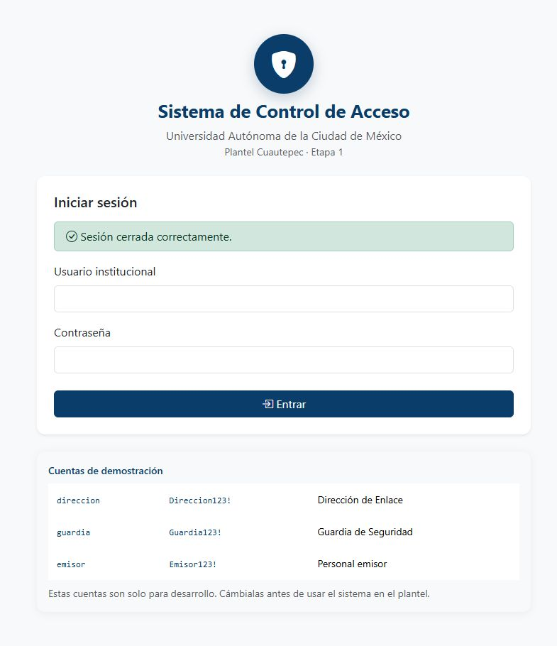
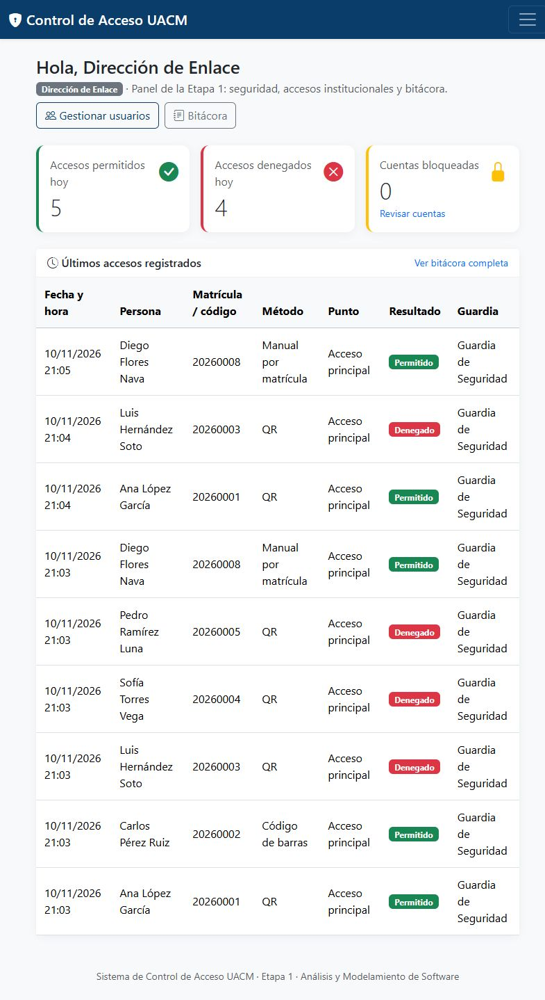
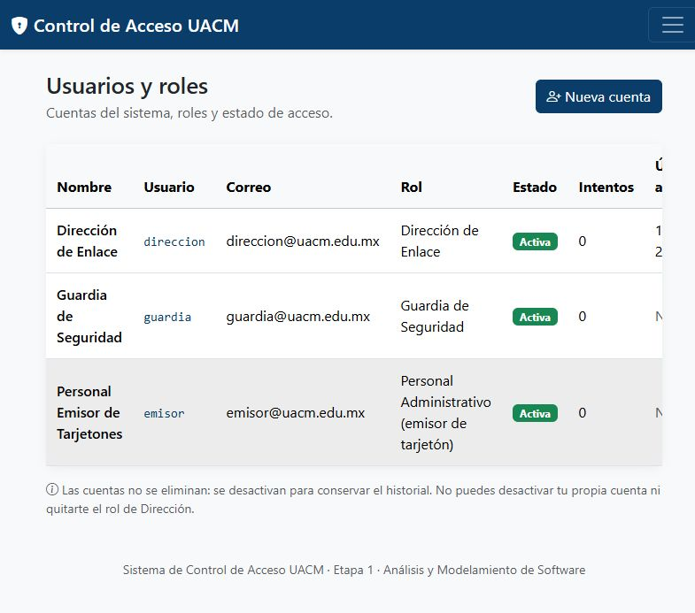
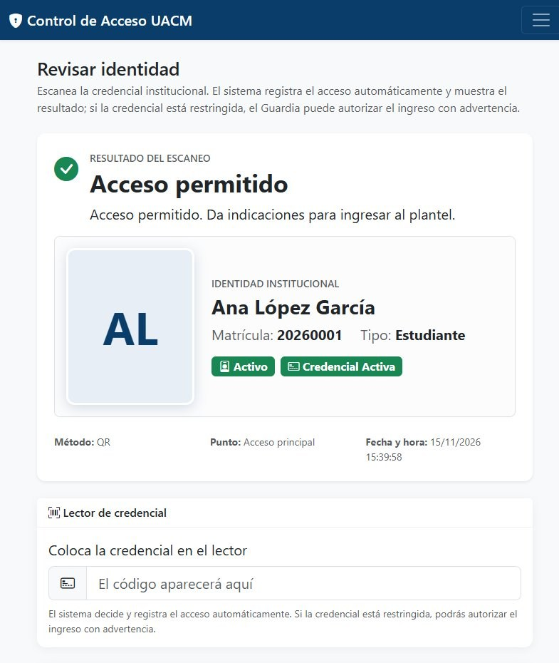
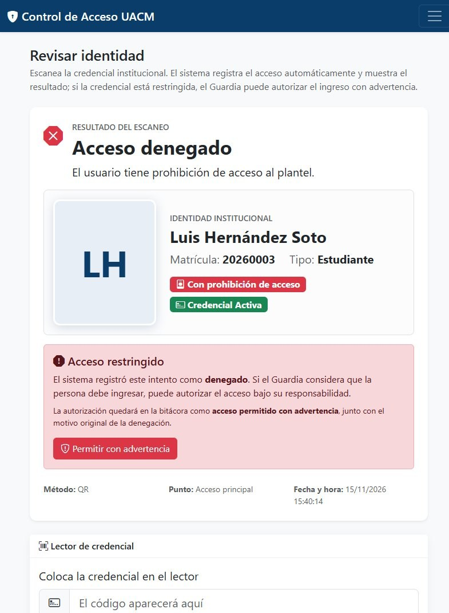
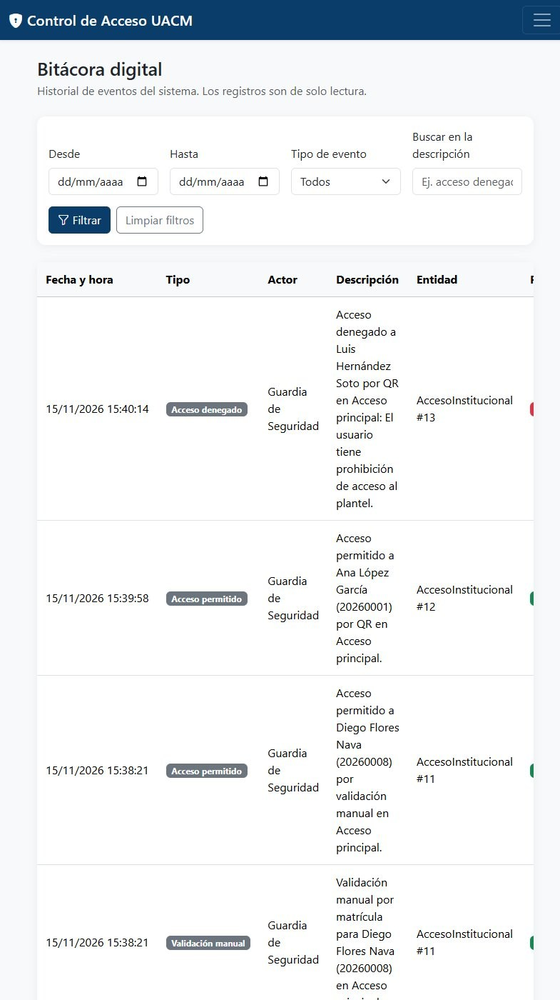

# Guía de ejecución y revisión — Etapa 1

**Sistema de Control de Acceso UACM**
Universidad Autónoma de la Ciudad de México · Plantel Cuautepec
Análisis y Modelamiento de Software

Esta guía está pensada para que una persona **sin conocimientos de programación** pueda
encender la aplicación, recorrerla y comprobar que la Etapa 1 cumple lo solicitado.

---

## 1. Qué vas a revisar

La Etapa 1 incluye cuatro bloques:

| Bloque | Qué podrás comprobar |
|---|---|
| Inicio de sesión y roles | Entrar con Dirección, Guardia o Emisor; cada rol ve solo lo que le corresponde. |
| Acceso institucional | Registrar automáticamente el acceso al escanear una credencial QR/código de barras; si está restringida, el Guardia puede autorizar con advertencia. La validación manual por matrícula se conserva. |
| Bitácora digital | Consultar el historial de accesos, sesiones y cambios, con filtros. |
| Gestión de usuarios | Crear cuentas, asignar roles, bloquear/desbloquear y desactivar cuentas. |

> **Importante:** la aplicación se entrega en dos modos.
>
> - **Modo demostración:** usa una base de datos temporal en memoria. **No requiere instalar MySQL.**
>   Es el modo recomendado para revisar.
> - **Modo MySQL/MariaDB:** es el modo de la entrega final. Se explica al final de esta guía.

---

## 2. Antes de empezar

Solo necesitas:

1. Windows 10 u 11.
2. **IntelliJ IDEA** instalado (la aplicación usa el JDK y Maven que IntelliJ incluye).
3. Un navegador: Chrome, Edge o Firefox.

No necesitas instalar Java, Maven, MySQL ni Docker para el modo demostración.

> En esta computadora ya está IntelliJ IDEA 2026.2.4, por lo que el modo demostración
> funciona sin instalar nada adicional.

---

## 3. Encender la aplicación (modo demostración)

### Paso 1. Abrir la carpeta del proyecto

Abre el Explorador de Windows y entra a:

```text
C:\Users\Usuario\Documents\control-acceso-uacm
```

### Paso 2. Ejecutar el arranque

Haz **doble clic** en:

```text
ejecutar-demo.bat
```

Se abrirá una ventana negra de consola. Es normal: ahí se muestran los mensajes del servidor.

> Si Windows muestra un aviso de seguridad, elige **Ejecutar de todas formas**.
> Si el archivo `.bat` no abre, haz clic derecho sobre `ejecutar-demo.bat` y elige
> **Ejecutar como administrador**.

### Paso 3. Esperar a que termine de arrancar

La primera vez, Maven descargará algunas librerías. Puede tardar **de 2 a 5 minutos**.
Las siguientes veces tardará menos de un minuto.

Sabrás que ya está lista cuando aparezca un mensaje parecido a:

```text
Started ControlAccesoApplication in ... seconds
Tomcat started on port 8080 (http)
```

**No cierres la ventana negra.** Mientras esté abierta, la aplicación estará funcionando.

### Paso 4. Abrir la aplicación en el navegador

Abre tu navegador y escribe:

```text
http://localhost:8080
```

Verás la pantalla de inicio de sesión:



---

## 4. Recorrido guiado

### 4.1 Entrar como Dirección de Enlace

En la pantalla de inicio de sesión captura:

| Campo | Valor |
|---|---|
| Usuario institucional | `direccion` |
| Contraseña | `Direccion123!` |

Haz clic en **Entrar**.

Verás el panel de Dirección:



**Qué revisar:**

- El nombre del usuario y su rol aparecen arriba.
- Hay tres indicadores: accesos permitidos hoy, accesos denegados hoy y cuentas bloqueadas.
- La tabla muestra los últimos accesos registrados, con fecha, persona, matrícula, método,
  punto de acceso, resultado y guardia.
- En el menú superior están **Usuarios** y **Bitácora**.

> Los datos que aparecen al arrancar son datos de demostración. Se cargan automáticamente
> para que puedas probar sin capturar todo desde cero.

---

### 4.2 Revisar usuarios y roles

En el menú superior haz clic en **Usuarios**.



**Qué revisar:**

- Aparecen las cuentas `direccion`, `guardia` y `emisor`.
- Cada cuenta muestra nombre, usuario, correo, rol, estado, intentos fallidos y último acceso.
- La cuenta `direccion` no tiene botón **Desactivar** (no puedes desactivar tu propia cuenta).
- Las cuentas no se eliminan: se desactivan para conservar el historial.

**Prueba opcional — crear una cuenta:**

1. Haz clic en **Nueva cuenta**.
2. Captura:
   - Usuario: `prueba2`
   - Nombre completo: `Cuenta de Prueba`
   - Correo: `prueba2@uacm.edu.mx`
   - Rol: `Guardia de Seguridad`
   - Contraseña temporal: `Prueba123!`
   - Confirmar contraseña: `Prueba123!`
3. Haz clic en **Crear cuenta**.
4. La cuenta aparece en la lista.
5. Si más adelante entras con `prueba2`, el sistema te obligará a cambiar la contraseña
   antes de usar cualquier módulo.

---

### 4.3 Salir y entrar como Guardia

1. En la esquina superior derecha haz clic en **Dirección de Enlace**.
2. Elige **Cerrar sesión**.
3. En la pantalla de inicio de sesión captura:

| Campo | Valor |
|---|---|
| Usuario institucional | `guardia` |
| Contraseña | `Guardia123!` |

4. Haz clic en **Entrar**.

Verás el panel del Guardia. Observa que **ya no aparece el menú Usuarios**; el Guardia solo
puede revisar identidades y consultar la bitácora.

---

### 4.4 Revisar la identidad con una credencial

En el panel del Guardia haz clic en **Revisar identidad**.

Coloca el cursor en **Coloca la credencial en el lector** y escribe (o escanea):

```text
UACM-20260001
```

Presiona **Enter**. El sistema registra el acceso en ese momento.

**Resultado esperado:** aparece una tarjeta verde con:

- Título: **Acceso permitido**
- Iniciales **AL** (en la entrega final será la fotografía del directorio institucional).
- Nombre: **Ana López García**
- Matrícula: **20260001**
- Tipo: **Estudiante**
- Estatus: **Activo**
- Credencial: **Activa**
- Método: **QR**
- Punto: **Acceso principal**

El sistema decide automáticamente y registra el acceso como **Permitido**. El registro aparece
en **Mis últimos accesos registrados** y en la bitácora como **Acceso permitido**.



> Si tienes un lector USB de QR o código de barras, funciona como un teclado: coloca el cursor
> en el campo y escanea la credencial. El lector envía el código y la información aparece
> automáticamente.

> **¿No tienes lector físico?** Usa tu teléfono como lector inalámbrico. Sigue la guía
> [Usar tu teléfono como lector](docs/COMO-USAR-TU-TELEFONO-COMO-LECTOR.md) y escanea los
> códigos de la hoja [Credenciales de prueba QR](docs/credenciales-qr.html) o del
> [PDF imprimible](docs/credenciales-qr.pdf).

---

### 4.5 Revisar credenciales con estatus especial

Repite el escaneo con estos códigos:

| Código | Lo que verás |
|---|---|
| `UACM-20260003` | **Acceso denegado** para **Luis Hernández Soto** por **prohibición de acceso**. La tarjeta muestra la advertencia y el botón **Permitir con advertencia**. |
| `UACM-20260004` | **Acceso denegado** para **Sofía Torres Vega** por **credencial vencida**. También permite autorizar con advertencia. |
| `UACM-20260005` | **Acceso denegado** para **Pedro Ramírez Luna** por **credencial bloqueada**. También permite autorizar con advertencia. |
| `NO-EXISTE` | **Acceso denegado** porque la credencial no existe. No se puede autorizar. |



En los tres primeros casos el sistema registra el acceso como **Denegado** y deja el botón
**Permitir con advertencia**. Si el Guardia lo usa, se registra un segundo evento como
**Acceso permitido con advertencia**, conservando el motivo original. La credencial no
reconocida solo se deniega y queda en la bitácora.

---

### 4.6 Validación manual por matrícula

Sirve para cuando la persona no trae credencial y presenta su cédula de selección de cursos.

En la sección **Validación manual por matrícula**:

1. Captura la matrícula:

```text
20260008
```

2. Haz clic en **Buscar y validar**.

Aparece una pantalla de confirmación con:

- Iniciales **DF**
- Nombre **Diego Flores Nava**
- Matrícula **20260008**
- Tipo **Estudiante**
- Estado **Activo**

3. Revisa que los datos correspondan a la persona.
4. Haz clic en **Confirmar acceso**.

**Resultado esperado:** aparece la tarjeta verde de confirmación con el acceso permitido y el
método **Manual por matrícula**. El acceso queda en la tabla **Mis últimos accesos registrados**.

> En este prototipo se muestran las iniciales porque todavía no se ha integrado el directorio
> institucional real de la UACM. La entidad ya tiene preparado el campo `fotografiaUrl` para
> conectarlo en una etapa posterior.

---

### 4.7 Consultar la bitácora

En el menú superior haz clic en **Bitácora**.



**Qué revisar:**

- Cada evento muestra fecha y hora, tipo, actor, descripción, entidad, resultado e IP.
- Aparecen los accesos por escaneo y las validaciones manuales que acabas de registrar.
- También aparecen los inicios y cierres de sesión.
- La bitácora es de **solo lectura**: no hay botones para editar ni borrar registros.

**Prueba de filtros:**

1. En **Tipo de evento** elige **Acceso permitido**.
2. Haz clic en **Filtrar**.
3. Verás los escaneos y validaciones permitidos, con el nombre de la persona.
4. En **Tipo de evento** elige **Acceso denegado** y haz clic en **Filtrar**.
5. En **Buscar en la descripción** escribe `Luis`.
6. Haz clic en **Filtrar**.
7. Verás únicamente los eventos de Luis Hernández Soto.
8. Haz clic en **Limpiar filtros** para regresar a la lista completa.

---

### 4.8 Comprobar que los roles están separados

**Como Guardia:**

1. Estando en la sesión de `guardia`, escribe directamente en el navegador:

```text
http://localhost:8080/admin/usuarios
```

2. **Resultado esperado:** pantalla “No tienes permiso para acceder a esta sección”.

**Como Dirección:**

1. Cierra sesión y entra con `direccion` / `Direccion123!`.
2. Escribe directamente:

```text
http://localhost:8080/guardia
```

3. **Resultado esperado:** la misma pantalla de acceso denegado.

Esto demuestra que la seguridad no depende solo de ocultar botones: el servidor también
rechaza las rutas no autorizadas.

---

### 4.9 Probar el bloqueo por intentos fallidos

Este flujo usa la cuenta `emisor` para no bloquear al Guardia que se usa en las demás pruebas.

1. Cierra sesión.
2. Intenta entrar con:

| Campo | Valor |
|---|---|
| Usuario | `emisor` |
| Contraseña | `incorrecta` |

3. Repite el intento **5 veces**.
4. En el quinto intento la cuenta queda **bloqueada**.
5. Intenta ahora con la contraseña correcta `Emisor123!`.
6. **Resultado esperado:** el sistema sigue rechazando el acceso porque la cuenta está bloqueada.

**Desbloquearla como Dirección:**

1. Entra con `direccion` / `Direccion123!`.
2. Ve a **Usuarios**.
3. Localiza la cuenta `emisor`: debe decir **Bloqueada** y **5** intentos.
4. Haz clic en **Desbloquear**.
5. La cuenta vuelve a estar **Activa** y con 0 intentos.

**Cambio obligatorio de contraseña:**

1. Cierra sesión.
2. Entra con `emisor` / `Emisor123!`.
3. El sistema te llevará directamente a **Cambiar contraseña** y no te dejará usar otro módulo.
4. Captura:
   - Contraseña actual: `Emisor123!`
   - Nueva contraseña: `EmisorNuevo123!`
   - Confirmar: `EmisorNuevo123!`
5. Haz clic en **Actualizar contraseña**.
6. El sistema cierra la sesión y muestra “Contraseña actualizada”.
7. Entra de nuevo con `emisor` / `EmisorNuevo123!`.

---

### 4.10 Cambiar la contraseña por voluntad propia

1. Entra con cualquier cuenta.
2. En la esquina superior derecha haz clic en el nombre del usuario.
3. Elige **Cambiar contraseña**.
4. Captura la contraseña actual, la nueva y la confirmación.
5. Al guardar, la sesión se cierra y debes entrar con la nueva contraseña.

**Reglas que debes comprobar:**

- La contraseña nueva debe tener al menos 8 caracteres.
- No puede ser igual a la actual.
- La confirmación debe coincidir.
- Si la contraseña actual es incorrecta, el sistema no permite el cambio.

---

## 5. Apagar la aplicación

1. Ve a la ventana negra de la consola.
2. Presiona **Ctrl + C**.
3. Si pregunta si deseas terminar el proceso, responde **S** (o presiona Enter).

La aplicación se detiene y el puerto 8080 queda libre.

> En modo demostración, al apagar la aplicación se borran los cambios que hiciste
> (cuentas nuevas, bloqueos, contraseñas cambiadas). Al volver a arrancar, los datos de
> demostración se cargan otra vez. Esto es intencional para poder repetir la revisión.

---

## 6. Checklist de aceptación de la Etapa 1

Marca cada punto cuando lo hayas comprobado:

- [ ] La aplicación abre en `http://localhost:8080`.
- [ ] Se puede iniciar sesión con `direccion`, `guardia` y `emisor`.
- [ ] El panel de Dirección muestra indicadores y accesos recientes.
- [ ] El Guardia puede escanear una credencial sin presionar un botón de validación.
- [ ] (Opcional) El escaneo funciona con el teléfono usando la guía de lector inalámbrico.
- [ ] La tarjeta muestra foto/iniciales, nombre completo, matrícula, tipo y estatus.
- [ ] El escaneo registra automáticamente un acceso permitido o denegado.
- [ ] Los casos restringidos muestran la advertencia y el botón **Permitir con advertencia**.
- [ ] Al autorizar con advertencia, se conserva el evento denegado y se registra el permitido.
- [ ] La validación manual por matrícula sigue pidiendo confirmación y registrando el acceso.
- [ ] Un acceso manual permitido muestra los datos de la persona y queda en la tabla.
- [ ] Un acceso manual denegado muestra el motivo y queda registrado.
- [ ] La bitácora muestra accesos, sesiones y cambios de cuenta.
- [ ] La bitácora se puede filtrar por tipo de evento y texto.
- [ ] El Guardia no puede entrar a `/admin/usuarios`.
- [ ] Dirección no puede entrar a `/guardia`.
- [ ] Dirección puede crear cuentas y asignar roles.
- [ ] Una cuenta se bloquea después de 5 intentos fallidos.
- [ ] Dirección puede desbloquear la cuenta.
- [ ] Al desbloquear, el usuario debe cambiar su contraseña.
- [ ] No se puede desactivar la propia cuenta de Dirección.

---

## 7. Modo MySQL/MariaDB (entrega final)

El modo demostración usa H2 en memoria. Para la entrega formal, la aplicación está preparada
para MySQL 8 o MariaDB 10.6+.

### 7.1 Requisitos

- MySQL 8 o MariaDB instalado y corriendo en `localhost:3306`.
- Usuario `root` con su contraseña.
- Maven y JDK 21+ (puedes usar los de IntelliJ).

### 7.2 Crear la base de datos

Abre una terminal en la carpeta del proyecto y ejecuta:

```bash
mysql -u root -p < database/init.sql
```

Esto crea:

- Base de datos: `control_acceso_uacm`
- Usuario: `uacm`
- Contraseña: `uacm123`

### 7.3 Arrancar en modo MySQL

Desde IntelliJ IDEA:

1. Abre el proyecto `control-acceso-uacm` (archivo `pom.xml`).
2. Espera a que Maven descargue las dependencias.
3. Ejecuta la clase `ControlAccesoApplication`.
4. Abre `http://localhost:8080`.

Desde PowerShell:

```powershell
$env:JAVA_HOME = 'C:\Program Files\JetBrains\IntelliJ IDEA 2026.2.4\jbr'
$mvn = 'C:\Program Files\JetBrains\IntelliJ IDEA 2026.2.4\plugins\maven-plugin\lib\maven3\bin\mvn.cmd'
& $mvn spring-boot:run
```

> No actives el perfil `demo` en este modo. El perfil por defecto usa MySQL.

### 7.4 Configuración opcional

Si tu MySQL usa otro usuario, contraseña o puerto, define estas variables antes de arrancar:

| Variable | Valor por defecto |
|---|---|
| `DB_URL` | `jdbc:mysql://localhost:3306/control_acceso_uacm?...` |
| `DB_USER` | `uacm` |
| `DB_PASSWORD` | `uacm123` |
| `PORT` | `8080` |
| `APP_SEED` | `true` |

Para producción:

- Cambia las contraseñas de las cuentas de demostración.
- Desactiva los datos de demostración con `APP_SEED=false`.
- Usa migraciones Flyway o Liquibase en lugar de `ddl-auto=update`.
- Integra el directorio institucional real de la UACM para fotografías y vigencias.

---

## 8. Solución de problemas

### La ventana negra se cierra inmediatamente

Abre PowerShell en la carpeta del proyecto y ejecuta:

```powershell
powershell -NoProfile -ExecutionPolicy Bypass -File .\ejecutar-demo.ps1
```

Así podrás ver el mensaje de error completo.

### “No se encontró IntelliJ IDEA”

El script busca IntelliJ en `C:\Program Files\JetBrains`. Si lo instalaste en otra ruta,
edita `ejecutar-demo.ps1` y ajusta la variable `$idea`, o instala IntelliJ en la ruta habitual.

### “Port 8080 was already in use”

Ya hay otra aplicación usando el puerto 8080. Cierra la otra aplicación o arranca con otro puerto:

```powershell
$env:PORT = '8081'
.\ejecutar-demo.ps1
```

Luego abre `http://localhost:8081`.

### La página no carga

1. Revisa que la ventana negra siga abierta.
2. Espera a ver `Started ControlAccesoApplication`.
3. Verifica que escribiste `http://localhost:8080` y no `https`.
4. Prueba con otro navegador.

### “Usuario o contraseña incorrectos”

- Verifica mayúsculas y minúsculas: las contraseñas distinguen mayúsculas.
- Si hiciste 5 intentos fallidos, la cuenta se bloquea. Reinicia la aplicación en modo
  demostración para volver a los datos iniciales, o desbloquéala con `direccion`.

### La primera ejecución tarda mucho

Es normal: Maven está descargando dependencias de Internet. Las siguientes ejecuciones son
mucho más rápidas. No cierres la ventana durante la descarga.

---

## 9. Nota sobre el documento original

El documento “Etapa inicial - Sistema de Control de Access UACM” **no especifica lenguaje de
programación, framework ni gestor de base de datos**. Define una arquitectura MVC en capas con
una capa de persistencia. La elección de Java + Spring Boot + MySQL/MariaDB fue una decisión
del equipo para esta implementación.

---

## 10. Resumen de cuentas y datos de prueba

### Cuentas del sistema

| Usuario | Contraseña | Rol |
|---|---|---|
| `direccion` | `Direccion123!` | Dirección de Enlace |
| `guardia` | `Guardia123!` | Guardia de Seguridad |
| `emisor` | `Emisor123!` | Personal Administrativo (emisor de tarjetón) |

### Personas y credenciales

| Matrícula | Persona | Tipo | Credencial | Caso |
|---|---|---|---|---|
| `20260001` | Ana López García | Estudiante | `UACM-20260001` | Identidad activa |
| `20260002` | Carlos Pérez Ruiz | Estudiante | `UACM-20260002` | Identidad activa (código de barras) |
| `20260003` | Luis Hernández Soto | Estudiante | `UACM-20260003` | Estatus con prohibición de acceso |
| `20260004` | Sofía Torres Vega | Estudiante | `UACM-20260004` | Credencial vencida |
| `20260005` | Pedro Ramírez Luna | Estudiante | `UACM-20260005` | Credencial bloqueada |
| `DOC-001` | María Sánchez Díaz | Profesora | `UACM-DOC-001` | Identidad activa |
| `ADM-001` | José Ramírez Cruz | Administrativo | `UACM-ADM-001` | Identidad activa |
| `20260008` | Diego Flores Nava | Estudiante | Sin credencial | Validación manual |

---

**Fin de la guía.**
